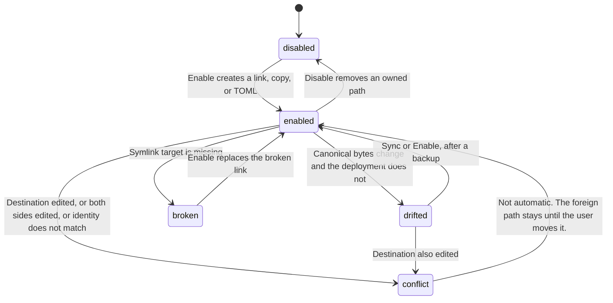
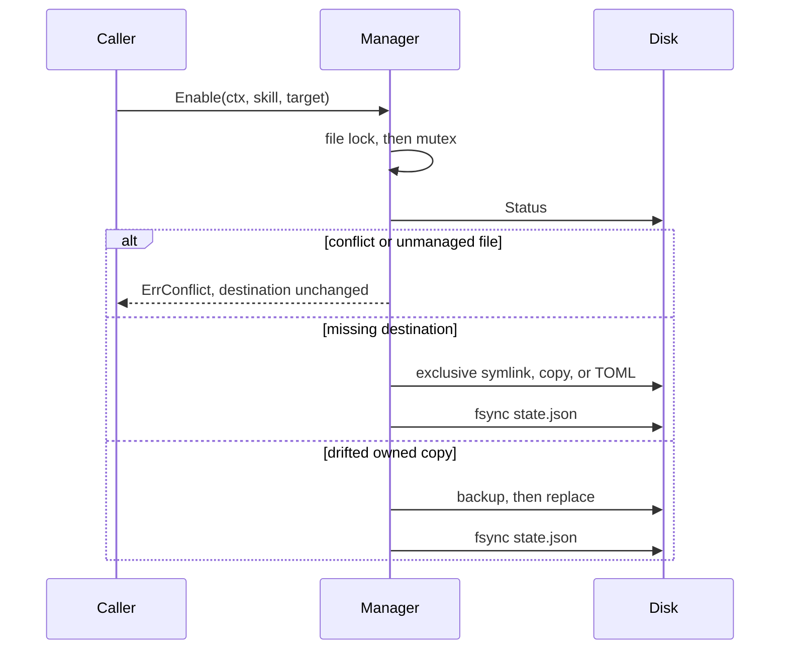

# Architecture

`pkg/core` owns the filesystem. `internal/cli` and `internal/ui` call it. The GUI is not imported by the library (`scripts/check-deps.sh`).

## Layout

- Canonical store: `~/.agent-skills/<skill>/SKILL.md` plus any sibling files the user put there.
- Config: `~/.agent-skills-manager/`. `targets.json` (schema version 1), `state.json` (schema version 1), `manager.lock`, and `backups/`.
- A deployment is a symlink, junction, copy, or TOML file in a target directory. The mode that was actually used is stored on the state record, including Windows fallback.

## State machine

`Status` returns one code per skill and target.

Equal content hashes are `enabled` even when the stored baseline differs. A TOML target whose generated file matches `IsGeminiTOMLMatch` is `enabled`. A ledger whose stored hashes disagree with both sides is `conflict`.

`Sync` writes only `drifted` cells. `conflict` is listed and left untouched. `Enable` of a `conflict` returns `ErrConflict`.

## Enable

Creates use exclusive rename or `os.Symlink` failure as the collision signal. A failed state write after a brand-new deployment removes that deployment. A failed state write after replacing a drifted copy leaves the new bytes and a backup; the next status is a conflict, so a later sync will not overwrite again.

## Disable

`Lstat` the destination. A symlink is removed only when its link text, after cleaning, is the canonical skill path. The link is not evaluated. A copy or TOML file is removed only when the state record's inode and device match, or when no inode was stored and the content hash matches. Removal opens with `O_NOFOLLOW` and checks the inode again. Recursive removal does not follow symlinks.

## Import

Copy the source to a staging directory, publish it into the canonical store, rename the source aside, link the canonical skill back, then remove the aside copy. If linking fails, the aside copy is moved back and the canonical publish is removed. The source is not deleted first. A zip import commits each skill on its own; a later skill's failure does not roll back skills already imported from that zip.

## Hash and archives

The directory hash is SHA-256 over relative paths in sorted order, with forward slashes. It streams file contents, ignores mtime and permissions, and skips `.git`, `.DS_Store`, and `Thumbs.db`. Symlinks are hashed as link text. Zip import rejects absolute names, `..`, backslashes, NUL, symlink entries, setuid and setgid modes, more than 10,000 entries, more than 512 MiB uncompressed, more than 64 MiB in one file, and a compression ratio above 100 once a file exceeds 1 MiB.

## Concurrency

Mutations take `manager.lock` (`flock` or `LockFileEx`) and then the process mutex. `Status` takes the read lock only. Nested mutations call the `Locked` methods; taking the public lock twice deadlocks. The watcher debounces (250 ms), ignores symlink directories, closes once, and is covered by a `goleak` test.

## Logging

The library accepts `*slog.Logger`. The default handler drops records. `pkg/core` does not call `os.Exit` or `log.Fatal`.
